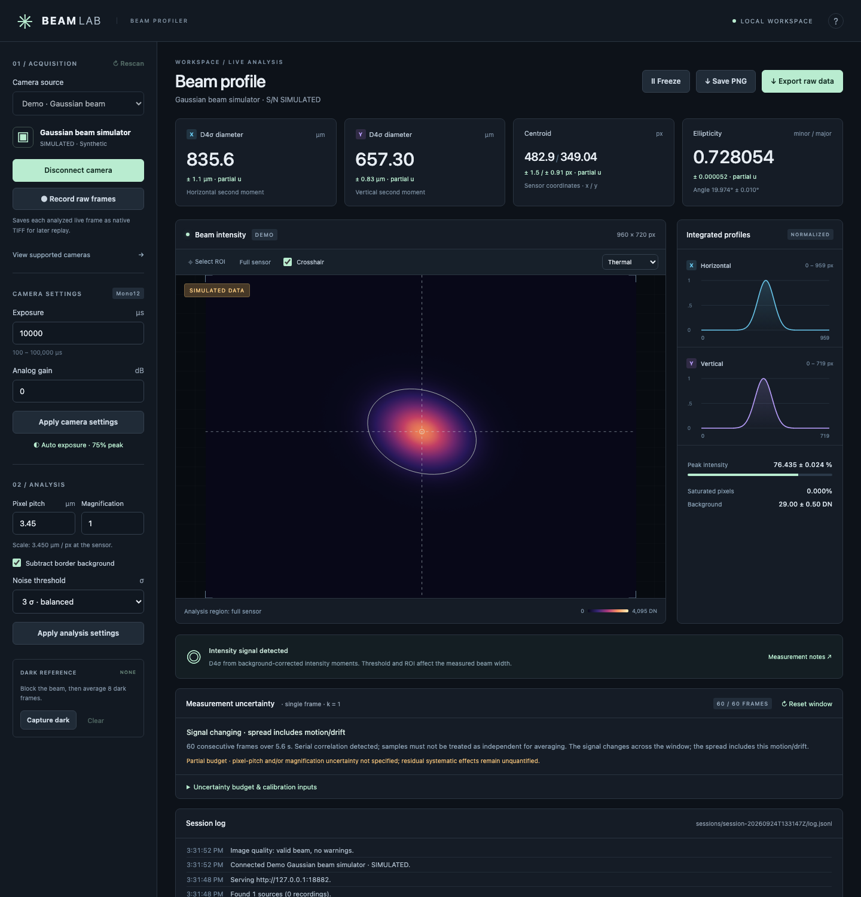
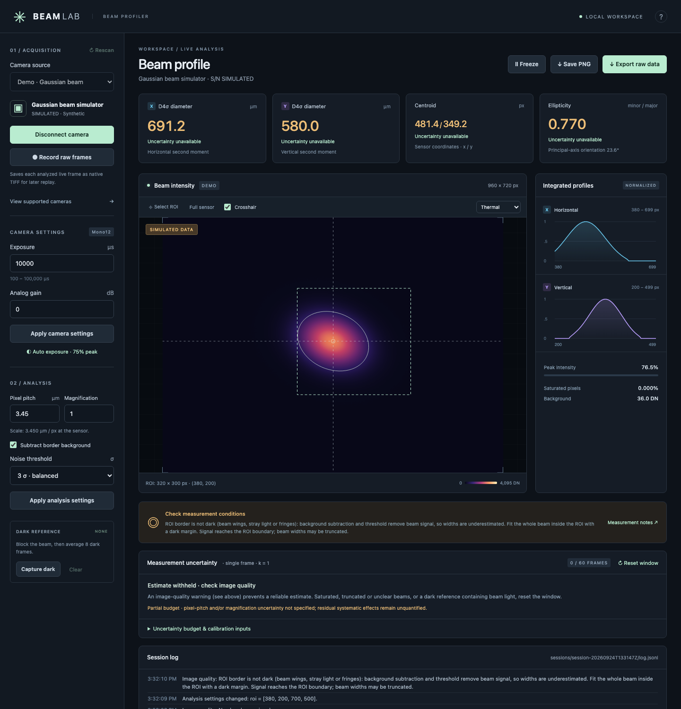
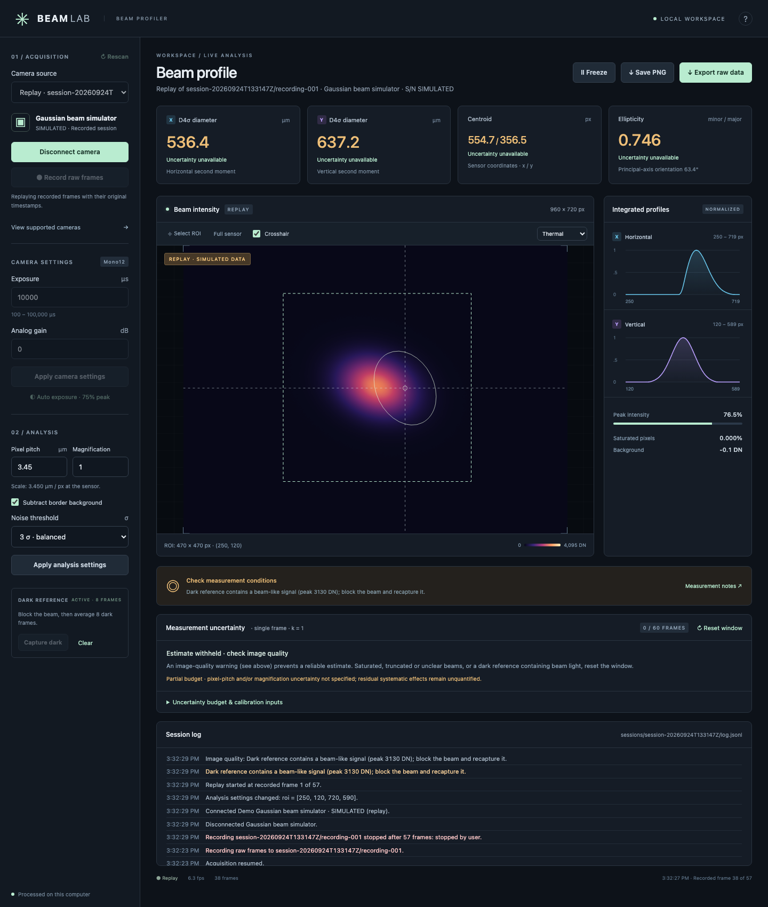
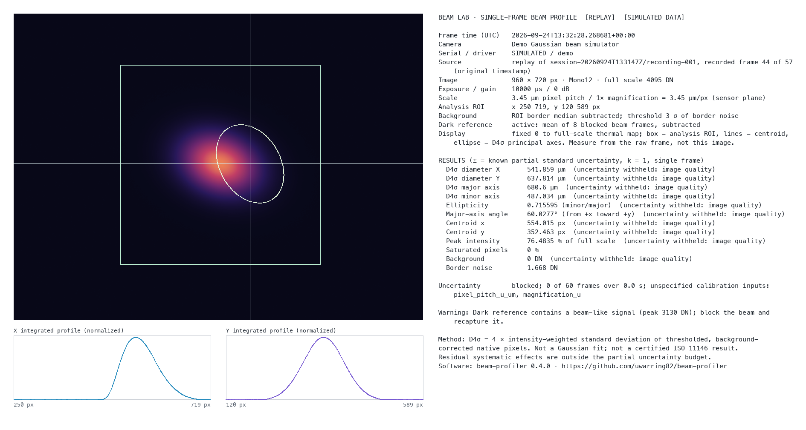

# Beam Lab

**[Open the browser profiler](https://uwarring82.github.io/beam-profiler/)** to explore five calibrated samples, open a monochrome PNG/TIFF or reopen a Beam Lab snapshot. Images and fits are processed on your device. Camera acquisition and recording use the [local application](#run).

[Start here](https://uwarring82.github.io/beam-profiler/start/) · [Beam path simulator](https://uwarring82.github.io/beam-profiler/beam-path/) · [Intensity fits](#transverse-intensity-fits) · [Session log & replay](#session-log-and-replay) · [Export format](#export-format) · [Uncertainty model](docs/uncertainty.md) · [Development logbook](docs/logbook.md) · [Entrance work programme](docs/work-programme-entrance.md) · [Citation](CITATION.cff) · [MIT license](LICENSE)

[](https://github.com/uwarring82/beam-profiler/actions/workflows/test.yml)

A local laser beam profiler with a browser UI and Python camera acquisition. Built and hardware-tested on an Apple Silicon Mac with a **FLIR Firefly FFY-U3-16S2M-DL**, serial **20415440**. Five simulated intensity profiles are available without a camera.

## Beam path simulator

Open either doubling stage. Move a lens by its marker or its numerical position, and inspect the two transverse radii with the probe. The coupler readout compares the incoming and target radii and reciprocal wavefront curvatures. **Optimize layout** previews a new set of lens positions. You can lock mounts, specify clearance from neighbors and rail ends, and supply alternative signed focal lengths. The multistart search retains lens order and can reach a local optimum. The result names each active clearance at a free lens, including both sides when relevant. The limits remain visible after applying a layout or repeating a search that finds no improvement. **Copy layout link** includes the optical configuration, minimum clearance and original profiler fit when available.

| Showcase from Friedenauer et al. (2006), under review | Pump → harmonic | Crystal | Curved-mirror separation | Round trip | Full fold | Paper's design waist |
| --- | --- | --- | --- | --- | --- | --- |
| [First stage, LBO](https://uwarring82.github.io/beam-profiler/beam-path/?stage=lbo) | 1118 → 559 nm | 18 mm, normal incidence | 62 mm | 400 mm | 10° | 27.3 µm |
| [Second stage, BBO](https://uwarring82.github.io/beam-profiler/beam-path/?stage=bbo) | 559 → 279.5 nm | 10 mm, Brewster cut | 59.4 mm | 470 mm | 27.4° | 19.4 µm |

The reference values come from §3 and Table 1 of [Friedenauer et al., *Applied Physics B* **84**, 371–373 (2006)](https://doi.org/10.1007/s00340-006-2274-2). Each stage is independently editable. The launch waist, injection lens values and placements, rail lengths (600 mm for LBO, 700 mm for BBO) and coupler location are illustrative. The rails are long enough that the optimized two-lens layouts stay clear of the coupler. The presets interpret the tabulated round trips as geometric lengths and take crystal length along the internal ray. The paper’s quoted 750 MHz LBO free spectral range corresponds to about 400 mm of round-trip group optical length. They use approximate scalar pump indices of 1.60 and 1.67 and 50 mm mirror curvature in both rings. The second stage inherits the 25 mm mirror focal length specified for the first stage. Table 1 gives measured harmonic conversion efficiencies of 52.7% and 28.9%.

**[Fibre launch](https://uwarring82.github.io/beam-profiler/beam-path/?stage=fiber)** matches the first stage with the fibre output coupler alone, as is common in the lab. The fibre mode is a Gaussian waist at the fibre tip with half the mode field diameter as its radius; use the diameter at the pump wavelength, since the quoted numerical aperture is not the beam divergence. The coupler is a thin lens of focal length f. Two settings remain: the focus offset δ of the fibre tip from f, and the distance D from the lens to the cavity input coupler. **Find focus and distance** searches δ within the coupler's focus travel and D within the bench range, starting from waist-to-waist imaging onto the mean of the two target planes (d₁ = f + (w₀/w_t)√(f² − f₀²), d₂ = f + (w_t/w₀)√(f² − f₀²), f₀ = π w₀ w_t/λ). For each focus setting it re-optimises the distance, because the optimum is a narrow ridge in focus and distance, and it evaluates the imaging estimate as a start of its own. The result is the ideal, unclipped spatial overlap. Beside it stands the power through the coupler's clear aperture, 1 − exp(−2a²/w²) for aperture radius a, and their product as the most that can couple. Active limits (focus travel, bench distances, a locked coupler) are named together with the overlap reached without them. Only the part of the loss that remains without limits is attributed to the cavity mode's tangential–sagittal difference, which a round fibre beam cannot follow. The 1% tolerances are one-sided where a stop blocks a direction. With L1 locked, only the distance changes. Invalid or empty inputs disable the search and the layout link, and the page names the field to correct. The focus offset counts from the effective focal length; a collimator's mechanical scale has a different zero, but changes in offset carry over. Students start by entering their own fibre (mode field diameter) and output coupler (effective focal length, focus travel, clear aperture) and the usable bench distances. Each of the four part values stays marked as an example (6.6 µm, 11 mm, ±0.5 mm, 5.5 mm) until it is changed or confirmed with “From my datasheet”, which also covers a datasheet value equal to the example. The search result names the unconfirmed values, and layout links keep the confirmations.

Propagation uses independent tangential and sagittal Gaussian q parameters with thin spherical or axis-aligned cylindrical lenses. The four-mirror cavity uses the stable round-trip fixed point at a plane input coupler. The two curved mirrors have effective focal lengths R cos(θ)/2 and R/(2 cos(θ)), where θ is **half** the full fold. For an internal ray path L and pump index n the plane-parallel crystal contributes L/n in both planes at normal incidence. At coplanar Brewster incidence it contributes L/n³ in the tangential plane, and the tangential beam radius expands by n inside the crystal. For derivations see [Kara, Appendix A](https://www.imperial.ac.uk/media/imperial-college/research-centres-and-groups/the-centre-for-cold-matter/public/Dhiren-Kara-%282010%29.pdf).

The reported overlap is the ideal power fraction coupled to an aligned, coaxial TEM₀₀ spatial mode. For each axis the factor is 2√(Im q₁ Im q₂)/|q₁ − q₂*|. Multiply both factors at the same reference plane. Conversion power requires additional nonlinear and loss data. The model omits walk-off, thermal lensing, clipping and angular or lateral alignment errors. Enter the focal lengths and crystal index at the intended wavelength. A calibrated Gaussian profiler fit can initialize the input radii under the explicit assumption that the measurement was made at a waist. Camera x must lie in the cavity plane. T and S use the 1/e² radii of the x and y intensity marginals. A rotated ellipse also has an x–y covariance that the separable propagation model omits. The import note gives the power overlap of the fitted field with this approximation at their assumed common planar waist. With principal radii u, v and marginal radii x, y, this overlap is 4h/(3+h²), where h = uv/(xy). The coupler readout is flagged when the input overlap falls below 99%. The input diagnostic describes the original fit and remains available in a shared link, including after edits to the source.

## Screenshots

Recorded with the built-in simulator ([all states](docs/images/)):

| Live measurement with uncertainty | Truncating ROI flagged |
| --- | --- |
|  |  |
| **Replay of a recording** | **Inspection PNG (Save PNG)** |
|  |  |

Further states: [offline](docs/images/01-offline.png), [warm-up](docs/images/02-warming-up.png), [saturated](docs/images/04-saturated.png), [ROI without beam](docs/images/05-roi-no-beam.png), [dark reference containing beam light](docs/images/07-frozen-dark-roi.png), [recording](docs/images/08-recording.png).

## Browser workbench

The public workbench starts with a precomputed sample measurement. **Open frame** reads a single 8/16-bit monochrome PNG/TIFF or a snapshot ZIP with its raw frame, dark reference and calibration. Standalone files start in pixels and use the full scale of their storage type. Set the effective scale and sensor maximum under **ROI & analysis settings** for unscaled 10/12-bit camera data. The image limit is 4 MP and the input file limit is 48 MiB.

**Run fit** loads the numerical runtime on demand and uses the same Python analysis and fitting modules as the camera application. The browser downloads pinned Pyodide 0.28.3, NumPy, Pillow and SciPy from jsDelivr. Frames stay on the device. Select a dark margin around the beam when drawing an ROI. The workbench flags a D4σ change above 10% when switching between the current threshold and 5σ (3σ if already at or above 5σ). This diagnostic is sensitive to noise and genuine weak wings. It does not correct the reported moments. The JSON export includes settings, scores and sampled integrated profiles. Residuals export at full ROI resolution as signed float32 TIFF.

The site is served from the repository root with GitHub Pages. For local development run `python -m http.server 8000 --bind 127.0.0.1` from that root. After changing the sample definitions or measured quantities, regenerate the example images and readouts with `python scripts/build_web_samples.py` in the project environment.

## Install

Python 3.11+ is required:

```sh
python3 -m venv .venv
source .venv/bin/activate
python -m pip install .           # or: python -m pip install -r requirements.txt
brew install aravis               # macOS; on Linux install your distribution's Aravis 0.8 runtime
```

Aravis is needed only for real cameras. It is discovered under `.vendor/aravis/*/lib`, Homebrew, or the system library path. Set `ARAVIS_LIBRARY` to an explicit library path if needed. On Apple Silicon macOS 26+, `scripts/setup_aravis_local.py` can instead place a checksum-verified Homebrew bottle in the project-local `.vendor/` directory, which is excluded from version control. Camera USB access must be allowed by the host operating system; sandboxed processes may discover no cameras even when USB hardware is attached.

## Run

```sh
python -m beam_profiler.server    # or: beam-profiler
```

Open **http://127.0.0.1:8877**, select the FLIR camera, and click **Connect camera**. Close other camera applications first. Use `--port 8878` if the port is busy. Stop with Ctrl-C to release the camera.

To reopen a previously exported frame, its camera settings and dark reference, use `python3 -m beam_profiler.server --restore-snapshot path/to/beam-snapshot.zip`. The same camera or source recording must be available. Saved fits are recomputed from the restored pixels. It starts frozen, with the uncertainty window cleared; **Resume** collects new samples. Historical frames are never treated as fresh repeatability data.

The application uses the open-source Aravis GenICam library rather than a vendor SDK such as Spinnaker, and does not modify any installed vendor software.

## Included

- Camera discovery, connection and clean release; explicit simulator source.
- Native monochrome acquisition, preferring Mono16, then Mono12/10/8.
- Exposure and gain controls with ranges and accepted values read from hardware.
- One-shot **Auto exposure** for beam profiling: sets exposure at the current gain so the brightest pixels reach about 75% of full scale.
- Fixed-scale thermal/grayscale image, centroid crosshair, D4σ ellipse, draggable analysis ROI.
- Intensity-weighted centroid, sensor-axis and principal-axis D4σ diameters, ellipticity and angle.
- Single-frame uncertainty from rolling repeatability, optional correlated scale calibration, and an explicit partial uncertainty budget.
- Integrated X/Y profiles, circular encircled-energy diameters (D50 and D86.5), peak intensity and image-quality warnings.
- On-demand 2D Gaussian, super-Gaussian, Hermite–Gaussian and Laguerre–Gaussian intensity fits with signed residual maps.
- Border background subtraction, adjustable noise threshold, averaged dark reference.
- Freeze/resume and ZIP snapshot export containing raw TIFF, measurement JSON, profile CSVs, a plain-text details file and the inspection PNG. An active dark reference is included as float TIFF.
- Session event log on disk and in the UI; raw-frame recording with SHA-256 manifest; replay of recordings through the same analysis.
- **Save PNG**: an inspection sheet with the color-mapped frame, ROI, centroid and D4σ ellipse, both profiles, and every acquisition setting, analysis setting, result, uncertainty and warning as plain text.

All capture and analysis run locally. The HTTP server binds only to loopback. The camera is opened only when selected and connected. Freeze retains the analyzed frame while acquisition continues to drain incoming buffers; resume displays fresh data. Disconnect releases USB ownership. Camera settings are adjusted in the current session; no camera user set is saved to flash.

## Measurement conventions

Analysis uses native, full-resolution intensity values; preview scaling and the color map do not affect measurements. D4σ means four intensity-weighted standard deviations. For an ideal Gaussian, this equals the 1/e² diameter. It is **not a Gaussian fit**. The ellipse and ellipticity use covariance principal axes; X/Y cards use image axes. Coordinates are relative to the delivered image, starting at the top left with y pointing down. The principal-axis angle is the major-axis direction measured from +x toward +y (clockwise as displayed), in the range −90° to +90°.

Processing subtracts an optional averaged dark reference, then the ROI-border median if enabled. Negative values and signal below the selected noise threshold are discarded. Noise is estimated using the larger of scaled border median absolute deviation and the upper 84.13th-percentile deviation; the latter handles black-clipped camera noise. Widths are withheld for low signal or isolated hot pixels. A truncation warning is raised when signal reaches the ROI edge: more than 1% of the corrected signal in the outer two rows/columns, a centroid ± 2σ extent outside the ROI, or an integrated profile at an ROI edge above 1% of its peak. The border must be dark: if its spread exceeds four times the pixel-to-pixel noise along the border (smooth beam wings, stray light or fringes rather than sensor noise), a warning states that background subtraction and thresholding remove beam signal and underestimate widths. Saturation is flagged at 99.8% of format full scale, including the left-aligned 10-bit Firefly ADC output in Mono16. Profiles sum corrected intensity; the UI normalizes each plot independently, while CSVs retain actual sums.

The Firefly pixel pitch is **3.45 µm**, from the [manufacturer specification](https://softwareservices.flir.com/FFY-U3-16S2-DL/latest/Model/spec.html). Physical scale is `pixel pitch / magnification`. At 1× this is a sensor-plane result. Verify optical magnification and effective pixel pitch if using camera binning, decimation or resized optical imaging. Unknown models default to pixel units. This version does not change camera binning or hardware ROI; the draggable ROI is analysis-only.

Thresholding, residual background, truncation, saturation and spatially nonuniform illumination affect second moments. Use an appropriate ROI and dark reference, and inspect profiles. These are practical estimates, not a certified ISO 11146 measurement system or an optical power calibration. No M² or propagation measurement is claimed.

**Auto exposure** is a one-shot adjustment, not the camera's mean-brightness auto mode (that stays disabled; it would saturate a small bright beam). It changes exposure only, keeping the gain, until the peak in the analysis ROI is 60–90% of full scale (target 75%). The peak is the 20th-brightest pixel, so a few hot pixels cannot set it. Each step discards one frame and evaluates the next. Exposure is scaled linearly above a low-percentile offset and divided by 4 while saturated, for at most 8 steps up to 1 s. If the camera limits are reached, the result says so (add ND or lower gain; raise gain or power). Like any exposure change, it clears the dark reference and the uncertainty window, so capture a new dark reference afterwards. The steps are logged.

Dark references average 8 fresh frames after draining older frames. Block the beam before capture. Each dark reference (captured, restored or replayed) is analyzed like a beam frame; if it contains a beam-like signal, every measurement using it carries a warning, the value cards turn amber and uncertainty estimates are withheld. The built-in simulators cannot block their beams, so a simulator dark reference shows this warning. Changing exposure/gain or switching cameras clears the reference. Capture requires exposure ≤1 s. Export after **Freeze** to retain the exact displayed frame; during live acquisition export uses the latest completed frame atomically.

### Encircled energy

D50 and D86.5 are the smallest circular-aperture diameters about the measured centroid enclosing 50% and $1-e^{-2}$ (86.47%) of the corrected ROI signal. Each pixel's signal is assigned to its center. For an ideal circular Gaussian, D86.5 equals its $1/e^2$ diameter. The same aperture definition applies to rings, lobes and irregular spots. Background, threshold and clipping affect the enclosed fractions. The values use the D4σ length calibration and are outside its repeatability budget.

## Transverse intensity fits

Select a camera, replay or demo source. In **Transverse intensity fit**, choose a template or **Compare all models** and click **Freeze & fit**. On a frozen image you can refit different templates, inspect the signed residual and export the frame. **Resume** returns to acquisition. The fit requires a valid frame with a clear margin around the beam and no acquisition-quality warnings.

The fitting coordinates $u,v$ are measured from a free center along rotated axes and divided by the radii $w_u,w_v$. Write $q=u^2+v^2$. Each model fits a nonnegative peak amplitude and a constant background. The shapes below are normalized to unit peak in the implementation.

| Intensity template | Shape up to normalization | Parameter convention |
| --- | --- | --- |
| Gaussian | $\exp(-2q)$ | Elliptical $1/e^2$ intensity radii |
| Super-Gaussian | $\exp(-2q^n)$ | Elliptical $1/e^2$ radii and order $1\le n\le 10$ |
| HG₁₀ | $u^2\exp(-2q)$ | Two lobes along $u$. Rotation also covers HG₀₁ |
| HG₁₁ | $u^2 v^2\exp(-2q)$ | Four lobes. Radii describe the Gaussian envelope |
| LG, $p=0$, $\lvert\ell\rvert=1$ | $q\exp(-2q)$ | Circular envelope with one radius. The ring peaks at $w/\sqrt{2}$ |

Both HG fits report envelope radii. Angles follow the image coordinate system (+x toward +y). The UI omits the angle of a circular ring or a Gaussian/super-Gaussian with less than 1% axis asymmetry. The latter threshold is a display convention. JSON retains the fitted angle for reconstructing an elliptical template.

The optimizer uses native ROI samples after optional dark subtraction, retaining negative values. Moment settings supply initial estimates and quality checks. The fit estimates its own offset and fits the unthresholded data. For large ROIs it samples a finer grid around the beam and weights each sample by the pixel area it represents. The reported RMS in digital numbers (DN) and $R^2$ use **every native ROI pixel**. The signed residual is measured intensity minus prediction, including the fitted background. Red indicates excess light and blue a deficit. The preview averages pixels for display. The exported residual retains the native grid.

Compare the same ROI across models. A large dark margin can dilute an RMS error, and the extra super-Gaussian parameter can give a small improvement even for Gaussian data. Spatial structure in the residual helps distinguish mismatch from camera noise. These are intensity-template fits at one plane. Optical phase, LG charge sign, coherent mode fractions and propagation $M^2$ require additional measurements. The software assigns no fit-parameter confidence intervals. [Hermite–Gaussian modes](https://www.rp-photonics.com/hermite_gaussian_modes.html) · [Laguerre–Gaussian modes](https://www.rp-photonics.com/laguerre_gaussian_modes.html)

## Uncertainty estimates

Live results show **± known standard uncertainty (k = 1)** after at least 20 consecutive valid frames, using a rolling 60-frame window by default. Because a card is a single-frame result, the temporal component is the sample standard deviation, **not** the standard error of a mean. Beam motion is included in that spread; correlation and drift are flagged. Saturated, truncated or invalid images reset the window and withhold estimates.

Open **Uncertainty budget & calibration inputs** to inspect window means, temporal spread, scale contributions and the known subtotal. Pixel-pitch and magnification uncertainties are currently unknown and remain “not specified.” Enter them later as absolute standard uncertainties. The propagation includes their correlation and the shared scale covariance between diameters. Fixed-reference errors and residual systematic effects are explicitly outside the budget, so the result stays labeled **partial**.

The export now also contains `uncertainty-samples.csv` and full uncertainty metadata/covariances in `measurement.json`. See [the measurement model and limitations](docs/uncertainty.md) for equations, reset rules, circular-angle handling and references.

## Session log and replay

Each server run creates `sessions/session-<UTC time>/` (change with `--sessions-dir`; the folder is ignored by version control). Its `log.jsonl` has one JSON object per line: `seq`, UTC `time`, `event`, a plain-text `message` and structured `data`. Logged events include start, scans, connections, freeze/resume, requested and actual exposure/gain, analysis and uncertainty setting changes, dark captures, recordings, replays, PNG saves, exports, rejected commands, acquisition errors, and changes in image-quality state (at most every 2 s). The **Session log** panel shows the newest entries; every export ZIP includes the log as `session-log.jsonl`.

**Record raw frames** writes every analyzed live frame (not frames skipped while frozen) to `recording-NNN/` inside the session folder:

| File | Content |
| --- | --- |
| `recording.json` | Format version, software version, start/stop time and reason, frame count, camera info, analysis and uncertainty settings at start |
| `frames.csv` | `index, timestamp, file, sha256, exposure_us, gain_db, pixel_format, maximum_dn, dark_file` per frame |
| `frames/frame-NNNNNN.tiff` | Native, unscaled monochrome frame |
| `dark-NNN.tiff` | Each dark reference in use (32-bit float), referenced by `dark_file` |

Recording stops automatically at 5000 frames or below 2 GB free disk space; at full Firefly resolution a frame is about 3 MB. Recordings appear in the camera list as **Replay** sources (after stopping, or on rescan). Replay loops the recorded frames through the normal analysis, uncertainty, PNG and export paths, using the recorded timestamps, exposure, gain and dark references and verifying each frame's SHA-256. It starts from the recorded analysis settings, which remain editable. Exposure, gain and dark capture are locked. Each loop starts a new uncertainty window. Pacing follows the recorded intervals clamped to 0.02–1 s, so the original frame rate is only approximated. Exports from a replay identify the session, recording and frame.

## Export format

**Export raw data** writes one ZIP per frame, using open formats:

| File | Content |
| --- | --- |
| `raw.tiff` | Native-bit-depth monochrome frame (8 or 16 bit), unscaled |
| `dark-reference.tiff` | Averaged dark reference as 32-bit float, only if active |
| `measurement.json` | UTC timestamp, camera model/serial/format/exposure/gain, analysis settings, all metrics and warnings, full uncertainty result with covariance matrices and field order |
| `profile_x.csv`, `profile_y.csv` | `position_px,integrated_intensity_dn` over the analysis ROI |
| `fit-residual.tiff` | Present after fitting. Signed float32 DN, in the native ROI, for the lowest-RMS candidate. The ROI origin, model parameters for all candidates, calibrated length per pixel and scores are in `measurement.json` under `fit`. |
| `uncertainty-samples.csv` | The exact timestamped per-frame values in the current statistics window |
| `details.txt` | Plain-text (UTF-8) summary: time, camera and serial, format, exposure/gain, scale, ROI, background/threshold/dark settings, all results with uncertainties, warnings, method and software version |
| `inspection.png` | The same sheet as **Save PNG** |
| `session-log.jsonl` | The session event log up to this export |

Lengths are in the unit stated in `metrics.unit` (`µm` with a known pixel pitch, otherwise `px`); centroids are always in pixels. A snapshot can be reopened with `--restore-snapshot` as described above.

**Save PNG** writes only the inspection sheet (`beam-inspection-….png`) in the selected color map. The `details.txt` text is drawn on the sheet and also stored in the PNG's `Description` text chunk. The full `measurement.json` record is stored in a compressed `measurement.json` text chunk, so a standalone PNG still carries its metadata (read with `exiftool`, or `PIL.Image.open(path).text` in Python). The PNG is a display rendering; measure from `raw.tiff`.

## Add cameras

`beam_profiler/cameras/base.py` defines the driver protocol (`open`, `read`, `configure`, `close`). `Frame` carries a 2D native array, full-scale value and pixel-format name. `AravisCamera` supports the GenICam transport and queries the device's actual feature limits. Additional GenICam models may already discover, but need hardware validation; only the Firefly above has been verified. Color/Bayer and packed formats are not accepted by this version.

Add verified model calibration to `cameras/models.py`. To add another SDK, implement the protocol in a new adapter, add discovery and driver selection in `service.py`, and update the camera support dialog. No changes to analysis or rendering are required. All native calls must remain on the acquisition worker thread; buffers must be copied before release. Optional camera features vary by model and should be capability-checked in the adapter.

## Verify

```sh
python -m pip install '.[test]'
python -m pytest -q
node --check beam_profiler/static/app.js
```

Tests cover known Gaussian centroids and widths, rotation, ROI coordinates, calibration, saturation, dark subtraction, empty/noisy frames, invalid settings, freeze/resume, exact snapshot metadata, exports, dark invalidation and local HTTP access checks. Simulator tests do not require hardware.

Hardware validation on this Mac: discovery and opening by device ID; actual model and control bounds; 1440 × 1080 Mono16 frames; live browser acquisition. UI frame rate is a processing/preview rate, not a guarantee of the camera's maximum frame rate.

## Cite

If you use this software, please cite the version and Git commit used for your measurements. Citation metadata is in [`CITATION.cff`](CITATION.cff) (GitHub shows a “Cite this repository” button) and [`codemeta.json`](codemeta.json).

## License

MIT, see [`LICENSE`](LICENSE). Third-party runtime components keep their own licenses; see [`THIRD_PARTY.md`](THIRD_PARTY.md).
