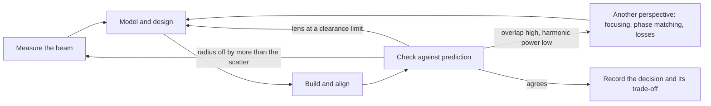

# Work programme: the Beam Lab entrance ("Start here")

Version 1.0 · 2026-11-24 · Owner: Ulrich Warring · For: whoever implements it, human or agent

This file is the brief. Implement it in order, keep the acceptance criteria, and record each finished work package in [the logbook](logbook.md).

## 0. What matters most

**Visitors should leave the first screen wanting to do the job properly.** "Properly" means a measured input beam, a justified design, a result checked against the prediction, and an honest statement of what the tools did not predict. Every decision below is judged against that goal. If a feature, a sentence or a colour does not serve it, leave it out.

The visitors are BSc and MSc students (FP-2, FP-EDU, theses) who have been given a beam task: mode matching into a doubling cavity, fibre coupling, focusing onto an ion, or characterising a laser.

## 1. Design brief: clean, so the intention is clear

Clean design is the main tool for focusing a visitor's intention, not decoration. A cluttered entrance tells students the task is a list of features. A calm one tells them it is a problem worth solving. Each rule below can be checked in review.

1. **One intention per view.** Each view has one heading, one sentence of purpose and one primary action. Everything else is quiet: secondary links, details behind `
`, no sidebars.
2. **Lead with the job, not the tool.** The first screen names the real problem in lab terms. The ²⁵Mg⁺ experiment needs 279.5 nm, made from 1118 nm in two doubling cavities, and whatever coupling is lost in the first stage is missing in the second. Tool names come second.
3. **Something to touch within ten seconds.** The landing page offers one live action straight away: open the LBO showcase, drag a lens, and watch the overlap change. Interest comes from handling the problem, not from reading about it.
4. **Progressive disclosure.** Nothing above the fold that isn't needed to choose a way in. Depth lives in the layer cards and the tools.
5. **Restraint in form.**
   - Reuse the existing Beam Lab style in `web/workbench.css`: Inter or system sans; ink `#172736` on `#f2f5f7`; lines `--line`; muted text `--muted`; the green accent `--green` with the `#4ea78c` header rule; the `#a16bd8` focus outline.
   - One accent colour per view.
   - No stock photographs, no decorative icons, no carousels, no counters, and no animation except to explain a beam.
   - Text measure at most about 70 characters. Generous whitespace.
6. **Plain words.**
   - Short sentences in the second person.
   - No unexplained jargon on the landing page; every technical term links to the glossary.
   - English first; a short German summary on each card.
7. **Honest limits are visible.** The difference between spatial overlap and harmonic power, and between a single image and a caustic, sits beside the results it qualifies, not in a footnote.
8. **Works next to the optical table.**
   - Readable and usable at 390 px width.
   - Tap targets at least 44 px.
   - No hover-only information.
9. **Accessible.**
   - WCAG 2.2 AA contrast.
   - Full keyboard use, headings in order.
   - A text equivalent for every diagram.
10. **Light.**
    - Static HTML and CSS, no framework, no build step, no analytics or tracking.
    - The landing page stays under 200 kB, excluding the tool pages it links to.

**Design review gate.** Before merge, attach screenshots at 1280 px and 390 px to the pull request and answer one question: after ten seconds on the page, can a new student say in one sentence what to do next? If not, simplify before adding anything.

## 2. Structure

### 2.1 Layers organise the tools

| Layer | Question it answers | Tools | Artefact | First pass |
| --- | --- | --- | --- | --- |
| 0 Orient | What am I being asked to do? | This page, one showcase | Task restated as target mode, constraints and success measure | 1 h |
| 1 Explore | What does a lens do to my beam? | Beam path simulator, LBO, BBO and fibre-launch showcases | Shared layout link and three short answers | 2 h |
| 2 Measure | What beam do I actually have? | Profiler (browser workbench or camera), fits, D4σ, D50/D86.5 | One export per plane at five or more planes (snapshot ZIP from the camera application, JSON from the browser workbench); w(z) table | Half a lab day |
| 3 Design | Which layout do I build, and did it work? | Simulator with measured input, lab lens catalogue, locks, clearance, optimiser | Layout link; predicted versus measured radii | 1–2 days |
| 4 Extend | The tools cannot do what I need | Repository, tests, logbook | Issue or pull request with a validation test | Thesis scale |

Each layer card contains:
- a goal and a self-check that lets a student skip the layer;
- three tasks with deep links that open the right tool in the right state;
- the artefact to hand in and the common traps;
- what the layer cannot settle, and which perspective will reopen it;
- a link to the install card for the student's operating system, where the layer needs software.

Entry questions on the landing page, each opening the lowest layer its task needs:

| Entry question | Opens |
| --- | --- |
| Understand Gaussian beams first | Layer 0 |
| Couple a beam into a cavity or fibre | Layer 1 |
| Focus a beam onto a target | Layer 1 |
| Characterise a laser beam | Layer 2 |
| The tools cannot do what I need | Layer 4 |

### 2.2 The work is a loop, not a ladder

The layers decide which tool a student opens; the work itself cycles between them. Each cycle is set off by a perspective the previous step left out. The landing page must show this loop, not a staircase:

Where perspectives pull against each other in the lab's own SHG chain (use these as worked examples):

| Decision | One perspective favours | Another pushes back |
| --- | --- | --- |
| Spot size in the crystal | Conversion: tighter focusing, up to an optimum | Cavity: stability margin and alignment tolerance; thermal effects at high power |
| Brewster-cut BBO | Cavity loss: no anti-reflection coating on the crystal faces | Mode: an astigmatic cavity mode, compensated by the fold angle; the UV leaves elliptical and needs a cylindrical telescope |
| Lens positions from the optimiser | Overlap: the highest number | Lab: mounts, inventory and clearance; the BBO preset uses a 700 mm rail; shorten it to 600 mm and the optimum sits at the coupler limit, which the page flags (use this as a worked example with the shorter rail selected explicitly) |
| Input beam for the simulator | Simulation: one waist and its position per plane | Measurement: a single image gives no curvature; ROI and threshold change the widths |
| Measure of success | Optics: spatial overlap near 100% | Experiment: harmonic power also depends on phase matching, losses and impedance matching; the published stages reached 52.7% and 28.9% |

When to go back:

1. The built beam misses the predicted radius by more than the measurement scatter: re-measure the input before re-optimising.
2. An optimised lens sits at a clearance limit: question the constraint (rail, inventory, mounts) before accepting the number.
3. Overlap is high but harmonic power is low: the limit lies in another perspective, not in the lens layout.
4. Two perspectives cannot both be satisfied: record the trade-off in the decision log and bring it to the checkpoint.
5. A perspective has no tool: Layer 4, or a documented workaround.

**Decision log.** Each student keeps one log across all layers. For every design choice it records what was chosen, what it traded away, and what evidence would reopen it. Supervisors discuss the log at each checkpoint. It shows, better than any single artefact, whether a student sees the task as a set of coupled trade-offs.

### 2.3 Installation runs alongside the layers

Layers 0 and 1, and Layer 2 with saved frames, need only a browser. Students start working before they touch a driver.

| Stage | Needed for | Installed | Operating systems |
| --- | --- | --- | --- |
| A · Browser | Layers 0–1; Layer 2 with saved frames | Nothing | Any |
| B · Python package | Layer 2 with simulator sources; Layer 4 | Python 3.11+, virtual environment, `pip install .` | macOS, Linux, Windows |
| C · Camera access | Layer 2 with a camera; Layer 3 | Aravis 0.8 plus USB access | macOS verified; Linux and Windows pending |

| Stage C | macOS | Linux | Windows |
| --- | --- | --- | --- |
| Aravis | `brew install aravis`; `scripts/setup_aravis_local.py` on Apple Silicon with macOS 26+ | Distribution package for Aravis 0.8 | MSYS2 packages; set `ARAVIS_LIBRARY` to the DLL |
| USB access | Granted by the system; sandboxed apps may see no camera | Copy `aravis.rules` to `/etc/udev/rules.d`, then replug | WinUSB bound to the camera, usually with Zadig; this can displace the vendor driver used by SpinView |
| Status | Verified with FLIR Firefly FFY-U3-16S2M-DL | Needs one validation session | Untested; library discovery covers macOS paths and the generic search only |

Every install card ends with the same four checks. A student reports the first one that fails:
1. `python -m beam_profiler.server` starts and a Demo source shows a beam.
2. `python -m pytest -q` passes (Layer 4 only).
3. `arv-tool-0.8` lists the camera.
4. **Connect camera** shows live frames at the expected size and format.

Camera work runs on one lab-maintained computer per setup. Students' own laptops cover Stages A and B. Don't publish a Linux or Windows camera card until a validation session on the actual lab computer has written it.

## 3. Files

| Path | Content |
| --- | --- |
| `start/index.html` | Landing: the problem, the ten-second action, entry questions, the loop, layer map, limits box, glossary, help |
| `start/layer-0.html` … `start/layer-4.html` | One card per layer (section 2.1) |
| `start/install-macos.html`, `install-linux.html`, `install-windows.html` | Install cards (section 2.3) |
| `start/decision-log.md` | Template: decision · alternatives · trade-off · evidence that would reopen it · date |
| `start/exercises/*.json` | Prepared `#layout=` exercises, regenerated when the layout format changes |
| `start/style.css` | Only what `web/workbench.css` lacks; no new palette |
| `index.html`, `beam-path/index.html` | "Start here" as the first navigation item |

Deep links that already work: `beam-path/?stage=lbo`, `?stage=bbo`, `#layout=…`, and `?wu=…&wv=…&angle=…` for a measured Gaussian fit.

## 4. Work packages

Do them in order. Each one is a pull request with screenshots at 1280 px and 390 px and a logbook line.

| WP | Deliverable | Accepted when |
| --- | --- | --- |
| 1 | Landing page and design frame | Passes the design review gate. The live action works on a phone. All five entry questions lead to a page, a stub if need be. |
| 2 | Layer cards 0–2 | Each card has every element in section 2.1, including a skip self-check, common traps and what the layer cannot settle. Every deep link opens the stated tool state. From “Focus a beam onto a target”, the Layer 1 action opens the simulator with “Specified waist in air” already selected. From “Couple a beam into a cavity or fibre”, the card also offers the fibre-launch showcase, where students enter their fibre's mode field diameter and their output coupler's focal length, focus travel and clear aperture. |
| 3 | Loop, trade-off examples, decision-log template | The loop is on the landing page with a text equivalent. Each trade-off row links to a place in a tool where the student can see it. |
| 4 | macOS install card; Linux and Windows cards marked "validation pending" | The four-step ladder works on a clean Mac. Pending cards say so in their first line. |
| 5 | CI checks | A test opens every internal link, loads every exercise through the app's validator, and asserts every number quoted on a card against the tools. Stage B runs on Ubuntu, macOS and Windows runners. |
| 6 | Caustic-fit notebook (workaround until the profiler fits w(z)) | It fits waist radius, waist position and M² from five or more exports (ZIP or browser JSON) and writes a full `#layout=` link with the fitted waists and positions; `?wu…` carries radii and angle only. M² stays visible as a separate result, because the simulator propagates an ideal Gaussian. |
| 7 | Layer cards 3–4 | Same criteria as WP 2. |
| 8 | Pilot (owner, not the implementer) | One FP-2 group and one BSc thesis student use the page. Stall points are recorded and acted on. |

The Linux and Windows camera validation sessions need hardware and a person at the lab computer. An agent prepares the cards; a person runs the sessions.

## 5. Content rules

- **No invented numbers.** Quote values only from the tools, the tests or a cited source. Every quoted number has a CI assertion (WP 5).
- **Showcase geometry.** The presets are labelled "from Friedenauer et al. (2006), under review" wherever they appear, including the simulator's own reference line, which currently says "Published", until §3 and Table 1 have been checked against the full text and the check is logged.
- **Supported systems.** Don't claim Linux or Windows camera support before its validation session.
- **Reuse.** Link to the README for methods; don't duplicate it.

## 6. Definition of done

- A new student, unprompted, reaches a live tool within ten seconds and can say what to hand in.
- Every page passes the design review gate and WCAG 2.2 AA checks.
- CI is green on all three operating systems for Stage B.
- The pilot's stall points are resolved or recorded as open issues.
- Measures of uptake are in place:
  - the share of reports with an export ZIP or layout link;
  - the time from task assignment to the first artefact;
  - issues and pull requests opened by students;
  - decision logs that record at least one choice reopened by evidence from another layer.

## 7. Known gaps

| Gap | Workaround | Fix |
| --- | --- | --- |
| No caustic fit | Notebook (WP 6) | Caustic fit in the profiler, feeding the simulator |
| No focusing optimum in the crystal (Boyd–Kleinman) | Compare the crystal-centre radius with SNLO | Show L/b beside the crystal radius |
| No conversion or build-up model | Report overlap and measured power separately | Out of scope; link to SNLO and the cavity literature |
| No lens-tolerance readout | Drag each lens ±1 mm | Optimiser reports d(overlap)/dz per lens |
| Fits not validated on the Firefly | Simulator frames for training | One documented session |
| Camera access validated on macOS only | Saved frames on Linux and Windows | One validation session per system |

## Sources

- [Aravis: USB devices](https://aravisproject.github.io/aravis/aravis-stable/usb.html): udev rules for USB3 Vision access on Linux
- [Teledyne FLIR: Getting started with Aravis in Linux](https://www.teledynevisionsolutions.com/support/support-center/application-note/iis/getting-started-with-aravis-in-linux/)
- [Aravis repository](https://github.com/AravisProject/aravis): MSYS2 packages for Windows
- [Zadig](https://zadig.akeo.ie/): generic USB drivers (WinUSB) on Windows
- [Friedenauer et al., Appl. Phys. B 84, 371–373 (2006)](https://doi.org/10.1007/s00340-006-2274-2)
